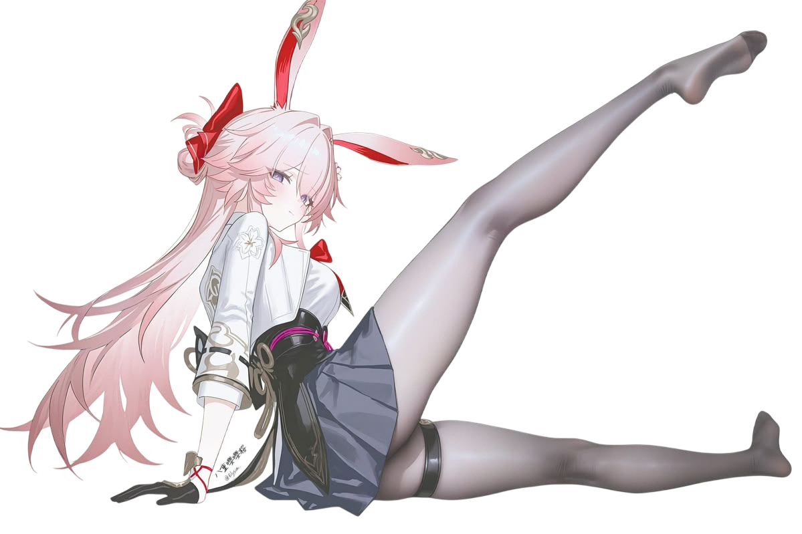

<div align="center">
  

  <a href="https://git.io/typing-svg">
    
  </a>

  <br/><br/>

  <a href="https://t.me/torroixq">
    
  </a>
  <a href="https://www.youtube.com/@torroixq">
    
  </a>

  <br/>

  <a href="https://mynickname.com/id1848319">
    
  </a>

  <br/><br/>

  <a href="./README-RU.md">
    
  </a>
  <a href="./README.md">
    
  </a>
</div>

## 👻 Немного обо мне...

[](https://github.com/catoo-hub)

Привет! Я **torroixq** — разработчик и продуктовый дизайнер. Мне 19 лет) Мне нравится создавать цифровые продукты, в которых продуманный дизайн сочетается с качественной технической реализацией.

Мои основные направления — **frontend-разработка, full-stack-приложения и UI/UX-дизайн**. Люблю превращать идеи в полноценные продукты: от первых концепций и прототипов в Figma до работающих веб-приложений.

У меня есть опыт коммерческой веб-разработки, участия в создании B2B/B2C-платформы и развития собственного цифрового маркетплейса **AEPSTORE**.

Особенно интересуюсь современными веб-технологиями, архитектурой приложений, креативными инструментами и применением искусственного интеллекта в разработке.

**Немного фактов обо мне:**
- 🎨 Увлекаюсь UI/UX, моушн-дизайном и визуальным сторителлингом.
- 💻 Разрабатываю и поддерживаю собственные программные проекты.
- 🤖 Изучаю современные подходы к разработке и применение ИИ-инструментов.
- 🇯🇵 Изучаю японский язык и интересуюсь возможностями работы и жизни в Японии.

## 🛠️ Технологии и инструменты

```javascript
const torroixq = {
    role: "Frontend / Full-Stack разработчик и продуктовый дизайнер",
    os: [
        "Arch Linux",
        "Windows 11",
        "macOS"
    ],
    languages: [
        "JavaScript",
        "TypeScript",
        "Python",
        "PHP",
        "SQL"
    ],
    frontend: [
        "HTML5",
        "CSS3 / SCSS",
        "Vue.js",
        "Nuxt.js",
        "React",
        "Next.js",
        "Pinia"
    ],
    backend: [
        "Node.js",
        "NestJS",
        "FastAPI",
        "REST API",
        "GraphQL",
        "gRPC",
        "Protocol Buffers",
        "Prisma ORM"
    ],
    databases: [
        "PostgreSQL",
        "MySQL",
        "MongoDB",
        "SQLite",
        "Redis"
    ],
    tools: [
        "Git",
        "GitHub",
        "Docker",
        "Nginx",
        "Caddy"
    ],
    design: {
        product: [
            "Figma",
            "UI/UX-дизайн",
            "Прототипирование",
            "Компонентный дизайн"
        ],
        graphics: [
            "Adobe Photoshop",
            "Adobe Illustrator"
        ],
        motion: [
            "Adobe After Effects"
        ]
    },
    currentlyLearning: [
        "Продвинутый TypeScript",
        "Современный React и Next.js",
        "Японский язык"
    ],
    interests: [
        "Веб-разработка",
        "Продуктовый дизайн",
        "Open Source",
        "Креативные технологии"
    ]
};
```

## 🚀 Над чем я работаю

### AEPSTORE — цифровой маркетплейс

Собственный проект маркетплейса, объединяющий продуктовый дизайн, frontend-разработку и проектирование backend-архитектуры.

В рамках проекта я занимаюсь созданием пользовательских интерфейсов в Figma, проработкой архитектурных решений и координацией разработки с использованием ИИ-инструментов.

В техническом стеке используются **NestJS, Prisma, gRPC, Protocol Buffers** и другие современные технологии.

Проект постоянно развивается: мы пересматриваем архитектуру, улучшаем пользовательский опыт и адаптируем технические решения под новые требования.

### Фриланс-биржа для видеомонтажёров

Новый проект для портфолио, направленный на создание площадки, объединяющей видеомонтажёров, эдиторов, моушн-дизайнеров и заказчиков.

Пользователи смогут публиковать задания, искать исполнителей и откликаться на интересующие проекты.

Планируемый стек: **Next.js, TypeScript, PostgreSQL и Prisma**.

**Статус: в разработке.**

## ☕ Поддержать мои проекты

Если вам нравятся мои проекты или вы хотите поддержать мою работу над открытым программным обеспечением, вы можете отправить пожертвование на один из криптовалютных кошельков.

| Криптовалюта | Адрес |
|---|---|
| **TON / USDT (TON)** | `UQBuZXBiITcyXdaMaade8ZVBlMCB4ZXr3xWirszUUE7KC7qn` |
| **USDT (TRC20)** | `TYdgpf3CMrCTQNF5Ch5x3cEYKuoNBvzsYe` |
| **GRAM** | `UQBuZXBiITcyXdaMaade8ZVBlMCB4ZXr3xWirszUUE7KC7qn` |
| **BNB Smart Chain** | `0xcaddaf0fe660b0b178c07f5368b405f91cf4be43` |

## 📊 Статистика GitHub

<div align="center">


</div>

---

<div align="center">
<h3>Спасибо, что заглянули! До новых встреч, путник! 👻</h3>
</div>
