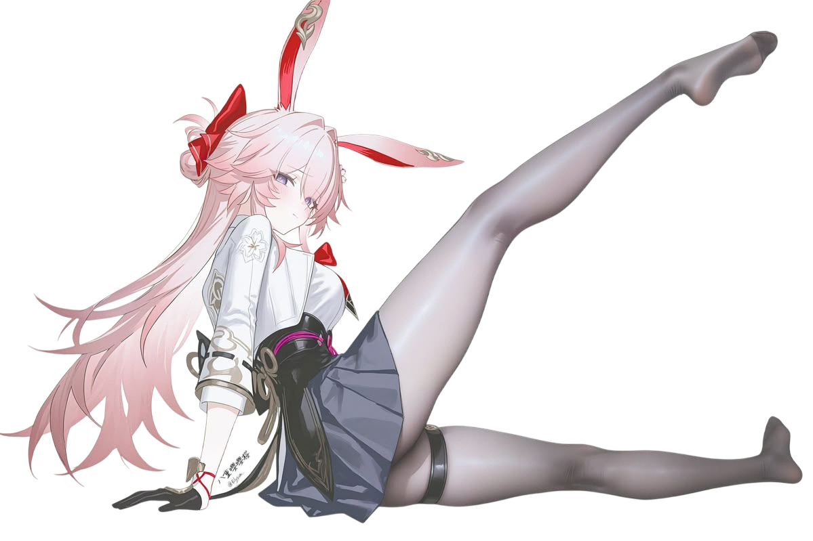

<div align="center">
  

  <a href="https://git.io/typing-svg">
    
  </a>
  
  <br/><br/>

  <a href="https://t.me/torroixq">
    
  </a>
  <a href="https://www.youtube.com/@torroixq">
    
  </a>

  <br/>

  <a href="https://mynickname.com/id1848319">
    
  </a>

  <br/><br/>

  <a href="./README-RU.md">
    
  </a>
  <a href="./README.md">
    
  </a>
</div>

[](https://git.io/typing-svg)

## 👻 A little about me...

[](https://github.com/catoo-hub)

Hey there! I'm **torroixq**, a developer and product designer passionate about building digital experiences that combine thoughtful design with practical engineering.

My main interests lie in **frontend development, full-stack applications, and UI/UX design**. I enjoy taking ideas from early concepts and Figma prototypes to functional web applications.

I've worked on commercial websites, contributed to a B2B/B2C platform, and continue developing my own digital marketplace, **AEPSTORE**.

I'm particularly interested in modern web technologies, scalable application architecture, creative tools, and AI-assisted development workflows.

**A few things about me:**
- 🏆 Multiple-time winner of international competitions.
- 🎓 Included in a state register of individuals with outstanding abilities.
- 🎨 Passionate about UI/UX, motion design, and visual storytelling.
- 💻 Building and maintaining independent software projects.
- 🤖 Exploring AI-assisted development and modern engineering practices.
- 🇯🇵 Learning Japanese and interested in opportunities in Japan.

## 🛠️ Technologies & Tools

```javascript
const torroixq = {
    role: "Frontend / Full-Stack Developer & Product Designer",
    os: [
        "Arch Linux",
        "Windows 11",
        "macOS"
    ],
    languages: [
        "JavaScript",
        "TypeScript",
        "Python",
        "PHP",
        "SQL"
    ],
    frontend: [
        "HTML5",
        "CSS3 / SCSS",
        "Vue.js",
        "Nuxt.js",
        "React",
        "Next.js",
        "Pinia"
    ],
    backend: [
        "Node.js",
        "NestJS",
        "FastAPI",
        "REST API",
        "GraphQL",
        "gRPC",
        "Protocol Buffers",
        "Prisma ORM"
    ],
    databases: [
        "PostgreSQL",
        "MySQL",
        "MongoDB",
        "SQLite",
        "Redis"
    ],
    tools: [
        "Git",
        "GitHub",
        "Docker",
        "Nginx",
        "Caddy"
    ],
    design: {
        product: [
            "Figma",
            "UI/UX Design",
            "Prototyping",
            "Component Design"
        ],
        graphics: [
            "Adobe Photoshop",
            "Adobe Illustrator"
        ],
        motion: [
            "Adobe After Effects"
        ]
    },
    currentlyLearning: [
        "Advanced TypeScript",
        "Modern React & Next.js",
        "Japanese"
    ],
    interests: [
        "Web Development",
        "Product Design",
        "Open Source",
        "Creative Technology"
    ]
};
```

## 🚀 What I'm Working On

**AEPSTORE — Digital Marketplace**

An independent marketplace project combining product design, frontend development, and backend architecture.

My work includes designing user interfaces in Figma, exploring application architecture, and coordinating AI-assisted development with technologies such as NestJS, Prisma, and gRPC.

**Freelance Marketplace for Video Editors**

A new portfolio project focused on connecting video editors, motion designers, and content creators with clients.

The goal is to build a functional web application using Next.js, TypeScript, PostgreSQL, and Prisma.

**Currently in development.**

## 🏢 My Organizations

<div align="center">
<table>
<tr>
<td>
  <a href="https://github.com/meowrch">
    
  </a>
</td>
<td>
  <a href="https://github.com/catoo-hub-Hackathons">
    
  </a>
</td>
</tr>
<tr>
<td>
  <a href="https://github.com/catoo-hub-Designs">
    
  </a>
</td>
<td>
  <a href="https://github.com/catoo-hub-EDUCATION">
    
  </a>
</td>
</tr>
</table>
</div>

> [!TIP]
> Some of my projects are hosted in these organizations rather than on my personal profile. Feel free to explore them!

## ☕ Support My Work

If you enjoy my projects or would like to support my open-source work, you can send a donation using one of the cryptocurrency wallets below.

| Cryptocurrency | Address |
|---|---|
| **TON / USDT (TON)** | `UQBuZXBiITcyXdaMaade8ZVBlMCB4ZXr3xWirszUUE7KC7qn` |
| **USDT (TRC20)** | `TYdgpf3CMrCTQNF5Ch5x3cEYKuoNBvzsYe` |
| **GRAM** | `UQBuZXBiITcyXdaMaade8ZVBlMCB4ZXr3xWirszUUE7KC7qn` |
| **BNB Smart Chain** | `0xcaddaf0fe660b0b178c07f5368b405f91cf4be43` |


## 📊 GitHub Statistics

<div align="center">


</div>

---

<div align="center">
*Thanks for stopping by. See you around, wanderer!* 👻
</div>
